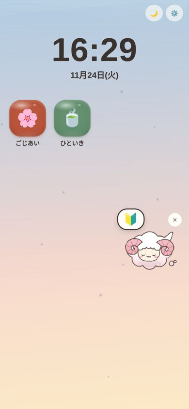
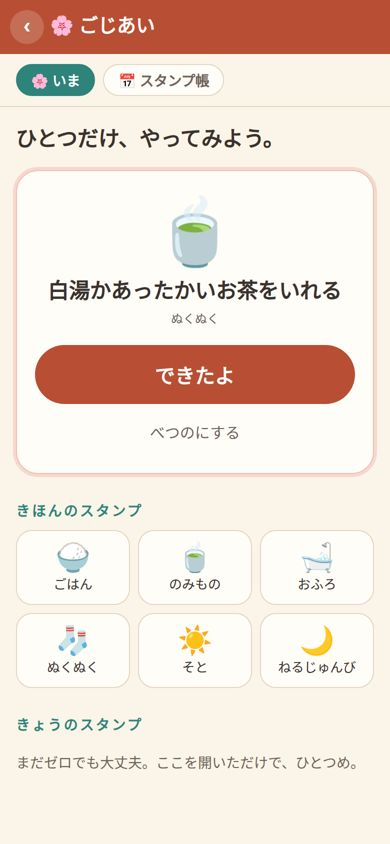
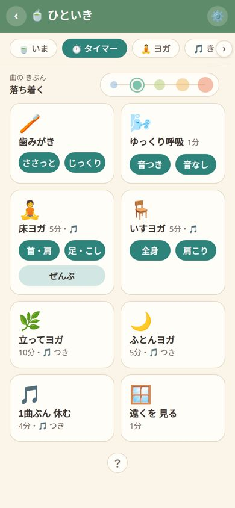
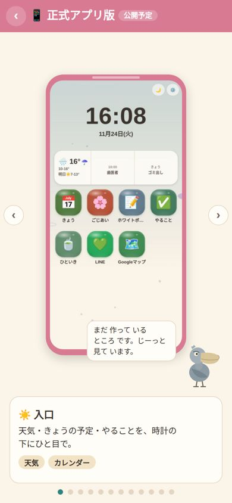

# Nukumado — a home screen that is gentle with you

  

[日本語](README.md)

Open it on your phone and it shows you just **one small thing** that would be good to do right now. A home screen built around three rules: no typing, no choosing, no blaming.

*Nukumado* (ぬくまど) roughly means "a warm window". The app itself is in Japanese only for now.

## Try it (phone only, nothing to install)

### 👉 **https://rryz09.github.io/nukumado/**

Just open it on your phone. Your records stay in your phone's browser and are never sent anywhere.

- 🌸 **Gojiai** (self-care): one small thing that suits you right now. Get a stamp when you do it
- 🍵 **Hitoiki** (a breather): timers for brushing teeth, slow breathing and yoga, plus a shelf of things you love
- 🔰 A few first-time questions set up your home screen for you

### Add it to your home screen

- Android (Chrome): ⋮ at the top right → "Add to Home screen"
- iPhone (Safari): the Share button → "Add to Home Screen"

It then opens from an icon, like an app.

### Where are my records?

Only in your phone's browser. Nothing is sent anywhere — see [PRIVACY.md](PRIVACY.md) (Japanese).
To move to a new phone, use ⚙️ Settings → "ℹ️ このアプリ" → "控えを取る / 戻す" (save / restore a backup file).

This repository *is* the trial site, served as-is by GitHub Pages.

## The full app (planned)

Beyond this trial, I hope to release a **full app** someday: it would gather your schedule, body, money, notifications and home devices **without typing**, by only reading from other apps and devices.
Whether and when it ships is not decided yet. You can see screenshots in ⚙️ Settings → "ℹ️ このアプリ" → "📱 正式アプリ版", and tell me through the Google Form at the end if you'd want it.

## Principles

- **No typing**: records come from other apps and devices. About the only thing you type is your name
- **No choosing**: only one thing is shown at a time
- **No blaming**: no streaks, no completion rates, no red warnings

## Problems and requests

In the app: ⚙️ Settings → "ℹ️ このアプリ" → "📮 こまった・こうしてほしい" opens a Google Form (no account needed; your device info is filled in automatically).
You can also open an [Issue](../../issues/new/choose) (GitHub account needed). English is fine. I make this alone, so replies may be slow.
Want to help? See [CONTRIBUTING.md](CONTRIBUTING.md). Security issues: see [SECURITY.md](SECURITY.md) — please don't post them publicly.

## Author

Ari (ありさん). I built this for myself, and I'm sharing it in the hope that it helps someone else too.

## Support

If you like Nukumado, you can support it via [GitHub Sponsors](https://github.com/sponsors/RRYZ09). Just using it makes me happy, too.

## License

- Code: [GNU AGPL v3.0](LICENSE)
- Art and sound (the yousei spirits, yoga illustrations, music, icons, etc.): all rights reserved by the author. They may only be used within this app → [LICENSE-ASSETS.md](LICENSE-ASSETS.md) (Japanese)
