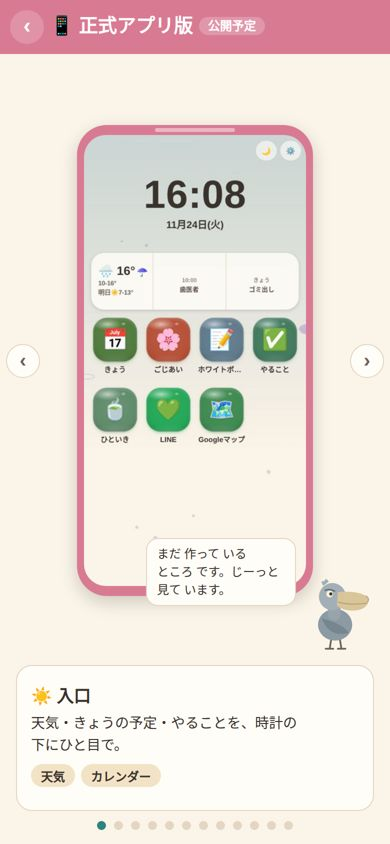

# ぬくまど — じぶんをいたわるホーム画面

  

[English](README.en.md)

スマホで開くと、いまやるとよい小さなことが 1 つだけ出る。入力させない・選ばせない・責めない、で作ったホーム画面です。

## ためす(スマホだけ・入れるものはありません)

### 👉 **https://rryz09.github.io/nukumado/**

スマホで開くだけで使えます。記録はあなたのスマホの中だけに残り、どこにも送りません。

- 🌸 **ごじあい**:  いまのじぶんにちょうどいい小さなことを 1 つ。できたらスタンプ
- 🍵 **ひといき**:  歯みがき・ゆっくり呼吸・ヨガのタイマー
- 🔰 はじめてのしつもんで、じぶんの入口に整えられます

### ホーム画面に置く

- Android(Chrome): 右上の ⋮ →「ホーム画面に追加」
- iPhone(Safari): 下の共有ボタン →「ホーム画面に追加」

置くと、アプリのようにアイコンから開けます。

### 記録はどこにある?

あなたのスマホの中だけです。どこにも送りません。くわしくは [PRIVACY.md](PRIVACY.md)。
スマホを替えるときは、⚙️ せっていの「控えを取る・戻す」で持ち運べます。

このリポジトリの中身が、そのまま体験版のページです(GitHub Pages)。

## 正式アプリ版のこと(公開予定)

体験版ではない **正式アプリ版** を、この先出せたらと考えています。予定・からだ・おかね・通知・家の電気などを、**入力なし** で(ほかのアプリや機器から読むだけで)まとめる形です。
出すかどうか、いつになるかは、まだ決まっていません。体験版の ⚙️ せってい →「ℹ️ このアプリ」→「📱 正式アプリ版」で、画面を見られます。ほしいと思ったら、そこから Google フォームで教えてください。

## 考えかた

- **入力させない**: 記録は、ほかのアプリや機器から読む。打つのは名前くらい
- **選ばせない**: 出すのは一度に 1 つ
- **責めない**: 連続記録・達成率・赤い警告を出さない

## 困ったとき・こうしてほしい

アプリの ⚙️ せってい →「ℹ️ このアプリ」→「📮 こまった・こうしてほしい」から、Google フォームで送れます(アカウントは要りません。どこのことかをえらんで、ひとこと書くだけ。つかっている機種などは自動で入ります)。
このリポジトリの Issues に直接書いてもだいじょうぶです(GitHub のアカウントが要ります)。1 人で作っているので、返事はゆっくりです。手を貸してくれる人は [CONTRIBUTING.md](CONTRIBUTING.md) へ。安全にかかわることは [SECURITY.md](SECURITY.md) へ。

## 作った人

ありさん。じぶんのために作ったものを、ほかの人にも使ってみてほしくて出しました。

## 応援する

ぬくまどを気に入ってくれたら、[GitHub Sponsors](https://github.com/sponsors/RRYZ09) で応援してもらえるとうれしいです。使ってくれるだけでも、とてもうれしいです。

## ライセンス

- コード: [GNU AGPL v3.0](LICENSE)
- 絵と音(ようせい・ヨガの絵・曲など): 作者が権利を持ったままです。このアプリの中で使うほかはできません → [LICENSE-ASSETS.md](LICENSE-ASSETS.md)
