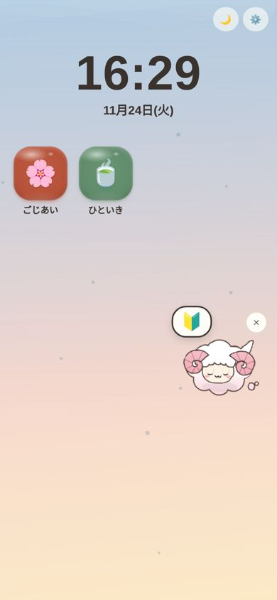
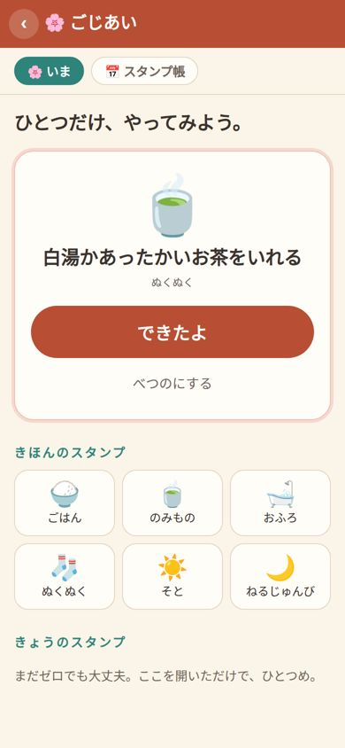
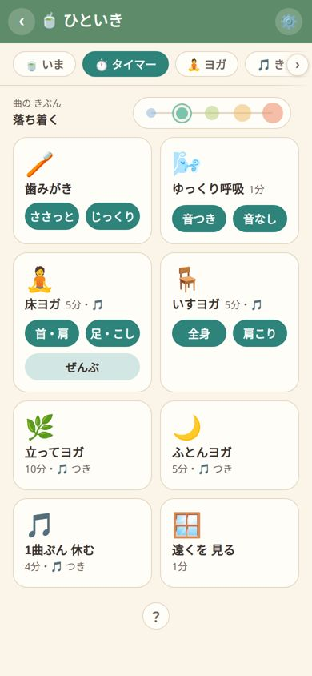

# ぬくまど — じぶんを いたわる ホーム画面

スマホで 開くと、いま やると よい 小さな こと が 1 つだけ 出る。入力させない・選ばせない・責めない、で 作った ホーム画面です。

## ためす(スマホだけ・入れる ものは ありません)

### 👉 **https://rryz09.github.io/nukumado/**

スマホで 開く だけで 使えます。記録は あなたの スマホの 中だけに 残り、どこにも 送りません。

- 🌸 **ごじあい**: いまの じぶんに ちょうどいい 小さな こと を 1 つ。できたら スタンプ
- 🍵 **ひといき**: 歯みがき・ゆっくり 呼吸・ヨガ の タイマー
- 🔰 はじめての しつもん で、じぶんの 入口に 整えられます

### ホーム画面に 置く

- Android(Chrome): 右上の ⋮ →「ホーム画面に追加」
- iPhone(Safari): 下の 共有ボタン →「ホーム画面に追加」

置くと、アプリの ように アイコンから 開けます。

### 記録は どこに ある?

あなたの スマホの 中だけ です。どこにも 送りません。くわしくは [PRIVACY.md](PRIVACY.md)。
スマホを 替える ときは、⚙️ せってい の「控えを 取る・戻す」で 持ち運べます。

この リポジトリの 中身が、そのまま 体験版の ページです(GitHub Pages)。

## 正式アプリ版の こと(公開予定)

体験版では ない **正式アプリ版** を、この 先 出せたら と 考えて います。予定・からだ・おかね・通知・家の 電気 などを、**入力なし** で(ほかの アプリや 機器から 読む だけで)まとめる 形です。
出すか どうか、いつに なるか は、まだ 決まって いません。体験版の ⚙️ せってい →「ℹ️ このアプリ」→「📱 正式アプリ版」で、画面を 見られます。ほしいと 思ったら、そこから Google フォームで 教えて ください。

## 考えかた

- **入力させない**: 記録は、ほかの アプリや 機器から 読む。打つのは 名前くらい
- **選ばせない**: 出すのは 一度に 1 つ
- **責めない**: 連続記録・達成率・赤い 警告を 出さない

## 困った とき・こうして ほしい

アプリの ⚙️ せってい →「ℹ️ このアプリ」→「📮 こまった・こうして ほしい」から、Google フォームで 送れます(アカウントは 要りません。どこの ことか を えらんで、ひとこと 書く だけ。つかって いる 機種 などは 自動で 入ります)。
この リポジトリの Issues に 直接 書いても だいじょうぶ です(GitHub の アカウントが 要ります)。1 人で 作って いるので、返事は ゆっくり です。

## 作った 人

ありさん。じぶんの ために 作った ものを、ほかの 人にも 使って みて ほしくて 出しました。

## ライセンス

- コード: [GNU AGPL v3.0](LICENSE)
- 絵と 音(ようせい・ヨガの 絵・曲 など): 作者が 権利を 持った まま です。この アプリの 中で 使う ほかは できません → [LICENSE-ASSETS.md](LICENSE-ASSETS.md)
